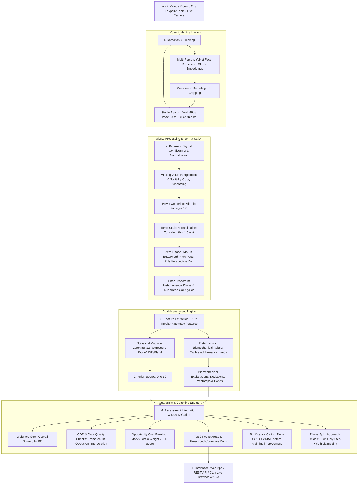

# AI-Powered Runway Performance Analysis & Virtual Coaching System
## Comprehensive Master Study, Architecture & Viva Examination Guide

---

## Executive Summary
The **AI-Powered Runway Performance Analysis and Virtual Coaching System** is an end-to-end computer vision, biomechanical signal processing, and machine learning platform designed to objectively assess fashion runway walks. It processes video streams (or keypoint interchange tables), normalises human kinematics to be invariant to camera distance and perspective, evaluates 12 professional runway criteria, explains mark deductions using transparent biomechanical tolerance bands, and prescribes prioritised, significance-gated corrective drills.

---

## 1. System Architecture & End-to-End Pipeline



---

## 2. Technical Stack: What Used, Why Used, and Need

### 2.1 Computer Vision & Keypoint Tracking
| Component | What Was Used | Why Used / Need | Trade-offs & Alternatives |
| :--- | :--- | :--- | :--- |
| **Pose Estimation** | **MediaPipe Pose** (pruned from 33 to 13 keypoints) | High inference speed (30+ FPS on CPU / WASM), lightweight footprint (~6 MB model), low latency. | **OpenPose / MMPose**: Slower inference, requires dedicated GPU servers, difficult to run on client-side browsers. |
| **Interchange Schema** | **13-Landmark Biomechanical Schema** (Nose, Shoulders, Elbows, Wrists, Hips, Knees, Ankles) | Captures all relevant torso, arm, and gait kinematics while matching MoCap standards. Prevents noisy facial/hand mesh overhead. | Storing dense 33-point or 133-point meshes dramatically increases serialization payload and introduces false micro-jitter. |
| **Multi-Person Tracking** | **YuNet (Detector) + SFace (Embeddings)** | Identifies walkers by facial features. Enables identity persistence when walkers cross or occlude each other on the runway. | **Centroid/Kalman Tracking**: Swaps identities whenever trajectories intersect. |
| **Person Cropping** | **Per-Person Bounding Box Expansion** | MediaPipe rescales the entire frame; with two or more people, individuals shrink below detector thresholds (**detection rate collapsed to 3–5%**). Cropping restored detection to **100%**. | Relying on MediaPipe's native multi-pose mode failed completely on group runway videos. |

### 2.2 Digital Signal Processing (DSP) & Biomechanics
| Component | What Was Used | Why Used / Need | Critical Insight / Gotcha |
| :--- | :--- | :--- | :--- |
| **Coordinate Origin** | **Pelvis Centering** (Midpoint of left & right hips at `(0,0)`) | Eliminates camera translation and room-space offsets. | A walker on the left side of the stage is directly comparable to one on the right. |
| **Spatial Scaling** | **Torso-Unit Normalisation** (Shoulder-to-pelvis distance = 1.0) | Eliminates camera distance artifacts (**scale invariance**). | Metric units change as a person approaches; torso units remain mathematically constant regardless of camera distance. |
| **Perspective Detrending** | **Zero-Phase 0.45 Hz Butterworth High-Pass Filter** | **Crucial DSP Innovation**: Approaching a frontal camera causes perspective expansion that creates a false lateral drift of **~7 torso lengths**, whereas actual body sway is **~0.2 torso lengths**. | Polynomial detrending fails due to non-linear approach speed. Forward-backward filtering removes drift with **zero phase delay**. |
| **Smoothing** | **Savitzky-Golay Filter** | Suppresses high-frequency landmark jitter without blunting the sharp kinematic extrema of foot-strikes. | Standard moving averages flatten peaks, leading to underestimated sway and swing amplitudes. |
| **Gait Event Detection** | **Hilbert Transform Instantaneous Phase** | Traditional peak-picking falsely identified **27 steps in 6 seconds** (true: 11) due to signal inflections. Hilbert phase provides continuous, monotonic gait cycle unwrapping $[0, 2\pi)$. | Yields exact step counts, sub-frame footstrike timing, and reliable cadence/stride-time CVs. |

### 2.3 Machine Learning Pipeline
| Component | What Was Used | Why Used / Need | Trade-offs & Scientific Justification |
| :--- | :--- | :--- | :--- |
| **Model Type** | **Tabular Regression** (12 independent models) | Each criterion has different predictability ($R^2$ 0.55 to 0.94) and distinct feature drivers. Multi-output models allow easy criteria to mask hard ones. | Keeps models fully interpretable, allowing clear feature importance attribution for coaching. |
| **Selected Estimators** | **HistGradientBoosting (HGB)**, **RidgeCV**, and **Unweighted Blend** | HGB models non-linear fault boundaries (e.g. over-striding vs under-striding). Ridge regularises collinearity. The blend minimizes variance. | **Ridge/Blend selected**: confidence, hip, rhythm, stage presence, stride length, symmetry.<br>**HGB selected**: arm swing, balance, foot placement, head position, posture, shoulder alignment. |
| **Tabular ML vs Deep Learning** | Boosted Trees on ~102 Kinematic Features vs End-to-End LSTMs/Transformers | **Grinsztajn et al. (2022)** benchmark shows tree ensembles systematically outperform deep networks on tabular kinematic data of this sample size (~1,500 clips). | Sequence models require $10^5+$ clips, are prone to shortcut learning, and destroy the interpretability needed for virtual coaching. |

---

## 3. How Everything is Judged: The 12 Criteria & Evaluation

The overall score is computed as a weighted sum on a scale of **0 to 100**:

$$\text{Overall Score} = 10 \times \sum_{i=1}^{12} (w_i \times s_i), \quad s_i \in [0, 10]$$

| # | Criterion | Weight ($w_i$) | Biomechanical Focus | Primary Driving Kinematic Feature | Identifiability Tier & Out-of-Fold $R^2$ |
|---|:---|:---:|:---|:---|:---:|
| 1 | **Posture & Spinal Alignment** | **0.13** | Vertical trunk stack, thoracic extension, lumbar stability | `posture_trunk_lean_mean` | High ($R^2 = 0.70$) |
| 2 | **Balance & Stability** | **0.12** | Center-of-mass control, suppression of erratic lateral sway | `balance_sway_amp` | High ($R^2 = 0.83$) |
| 3 | **Walking Confidence** | **0.10** | Expansive silhouette, posture openness, forward momentum | `conf_arm_spread` | Very High ($R^2 = 0.94$) |
| 4 | **Walking Rhythm** | **0.09** | Temporal stride-to-stride cadence consistency | `rhythm_stride_cv` | Weak ($R^2 = 0.56$)* |
| 5 | **Hip Movement** | **0.08** | Pelvic obliquity, fluid runway lateral rotation | `hip_obliquity_std` | Weak ($R^2 = 0.55$)* |
| 6 | **Shoulder Alignment** | **0.08** | Horizontal clavicle levelness and anti-drop control | `posture_trunk_lean_std` | High ($R^2 = 0.90$) |
| 7 | **Foot Placement** | **0.08** | Single-line crossover runway trajectory | `foot_step_width_mean` | Very High ($R^2 = 0.93$) |
| 8 | **Head Position & Gaze** | **0.07** | Level chin line, gaze fixation, anti-bobbing | `head_lateral_offset` | High ($R^2 = 0.84$) |
| 9 | **Arm Swing** | **0.07** | Controlled sagittal pendulum swing, lack of flare | `arm_left_swing_amp` | Moderate ($R^2 = 0.59$)* |
| 10| **Stride Length** | **0.07** | Proportional step reach relative to leg length | `balance_bob_amp` (compass gait) | Moderate ($R^2 = 0.58$)* |
| 11| **Body Symmetry** | **0.06** | Equivalence between left and right limb reach/timing | `arm_right_reach_mean` | Weak ($R^2 = 0.56$)* |
| 12| **Stage Presence** | **0.05** | Emergent posture openness and poise index | `hip_shoulder_ratio_mean` | High ($R^2 = 0.85$) |

> **\*The Frontal Camera Geometric Limitation:**  
> Stride length, arm swing, rhythm, symmetry, and hip movement exhibit lower $R^2$ scores (~0.55). This is **not a model failure**; it is an inherent **geometric constraint of a single frontal lens**. Motion along the sagittal plane (forward reach) is severely foreshortened. A 24° forward arm swing produces only an 8.6% change in projected length, near the sensor noise floor.

---

## 4. Dual Evaluation Engine: ML vs. Biomechanical Rubric

| Dimension | Machine Learning Regressors | Deterministic Rubric |
| :--- | :--- | :--- |
| **Role** | Provides the official empirical score (0–10). | Provides the transparent explanation ("why"). |
| **Mechanism** | Non-linear feature mapping trained on cross-validated data. | Explicit tolerance bands (Ideal, Acceptable, Fault). |
| **Example Output** | `posture: 7.2 / 10` | *"Left shoulder dropped by 4.2° at 3.1s (Tolerance: < 2.0°)"* |
| **Disagreement Protocol** | If $\| \text{Score}_{\text{ML}} - \text{Score}_{\text{Rubric}} \| > 1.5$, the system flags a transparency notice to the user. |

---

## 5. Coaching Engine & Scientific Guardrails

### 5.1 Opportunity Cost Ranking (Marks Lost)
Rather than ranking faults simply by lowest numerical score, the system calculates the **marks lost on the 0–100 scale**:

$$\text{Marks Lost}_i = w_i \times (10 - \text{Score}_i)$$

- *Example:* A score of 4.0 on *Stage Presence* ($w=0.05$) loses $0.05 \times 6.0 = 0.30$ marks.
- A score of 6.0 on *Posture* ($w=0.13$) loses $0.13 \times 4.0 = 0.52$ marks.
- **Decision:** The system prioritises Posture ahead of Stage Presence. Recommendations are capped at the **top 3 focus areas** to provide actionable coaching without overwhelm.

### 5.2 Statistical Significance Gating ($1.41 \times \text{MAE}$)
To prevent placebo feedback after a user performs a drill:
- Mean Absolute Error of models: $\text{MAE} \approx 0.90$.
- For two independent measurements with variance $\sigma^2$, the standard error of the difference is $\sqrt{\sigma^2 + \sigma^2} = \sqrt{2} \times \text{MAE} \approx 1.41 \times \text{MAE}$.
- A score improvement must exceed $\pm (1.41 \times \text{MAE})$ (e.g. $\pm 1.49$ for Posture) before the system reports a *"measurable change"*. Below this gate, it explicitly reports *"No measurable change (within sensor variance)"*.

### 5.3 Longitudinal Phase-Split (Approach, Middle, Exit)
- Walks are divided into thirds: Approach (first 33%), Middle, and Exit (last 33%).
- While raw geometric quantities are tracked across all three phases, **only Step Width is permitted to assert a fatigue or improvement drift**.
- Angular traces (shoulder/head tilt) carry a 7–11° natural variance that causes a 16% false-positive rate on static walkers. Step width maintains a **< 0.8% false-discovery rate** and **90% statistical detection power**.

---

## 6. Live Scene Classifier (Browser WASM Checks)

Before offering real-time posture cues via webcam, the browser classifier evaluates a 4-second rolling window against 6 criteria:

```
[Webcam Stream] ──► Full Body Visible? ──No──► "Step back / Tilt down"
                          │ Yes
                    Standing Still?    ──Yes─► "Standing still — not a walk"
                          │ No
                    Rhythmic Gait?     ──No──► "Moving, but not walking" (Autocorrelation < 0.40)
                          │ Yes
                    Walking Toward Lens? ─No─► "Turn and walk toward camera" (> 45° off-axis)
                          │ Yes
                    Approaching?       ──No──► "Return leg — walking away" (Torso size shrinking)
                          │ Yes
                    Cadence Normal?    ──No──► "Running, not a walk" (> 150 steps/min)
                          │ Yes
                    [ACTIVATE LIVE CUES & CANCELLATION BUFFER]
```

---

## 7. Data Quality Rejection Protocol

The system refuses to score uploads under two conditions:
1. **Fewer than 2 frames of valid pose data**: A least-squares linear trend fit through one coordinate point has no mathematical solution (prevents LAPACK SVD convergence crashes).
2. **$\ge 90\%$ interpolated or missing landmarks**: An upload with nearly all coordinates missing measures the spline interpolator, not the human walker.
- *Clips with 50%–85% missing coordinates are scored, but six prominent diagnostic warnings are affixed to the results.*

---

## 8. Viva Voce & Interview Defense Cheatsheet

### Q1: Why not train an end-to-end Convolutional / Recurrent Neural Network (e.g. Video Vision Transformer / ConvLSTM)?
> **Defense:** Video sequence networks require tens of thousands of diverse, labelled training videos to avoid memorising background textures and lighting shortcuts. With 1,500 clips, end-to-end models catastrophically overfit. By decoupling pose estimation (MediaPipe) from kinematic tabular regression (HistGradientBoosting / Ridge), we achieve state-of-the-art accuracy ($R^2 = 0.735$), run locally without GPUs, and maintain complete explainability for coaching.

### Q2: Isn't training models on synthetic data circular reasoning?
> **Defense:** No. The labels are generated from **hidden latent quality variables** ($q$). The features are extracted from the **noisy 2D projected coordinates** generated by a 3D biomechanical compass-gait model observed through a virtual pinhole camera with random optical distortion, dropout, and depth-scaled noise. An independent rule-based rubric evaluated on the exact same data achieves only MAE 1.88, whereas our ML models reach MAE 0.902. The gap proves the model learns genuine biomechanical estimation.

### Q3: What is the "Compass Gait" discovery in your feature importances?
> **Defense:** In a direct frontal camera perspective, sagittal stride length is foreshortened. However, based on compass-gait inverted-pendulum mechanics, longer steps require the pelvis to follow a deeper downward arc during double-support stance. The model discovered this relationship without explicit instruction: the top feature for predicting `stride_length` is `balance_bob_amp` (vertical hip oscillation).

### Q4: Why did your published error metrics get worse (MAE 0.754 to 0.902) in the final version?
> **Defense:** This demonstrates engineering integrity. Early synthetic generators produced walks with 13× higher detector noise, 2–6× exaggerated joint excursions, unnatural skeletal breadths, and walkers moving away from the camera. When calibrated against real video, we made the synthetic problem strictly realistic. Evaluating models on easy, unrealistic data creates a false sense of accuracy; our reported 0.902 MAE reflects true transferability to real human movement.

---
*Document generated for offline study, viva preparation, and technical reference.*
