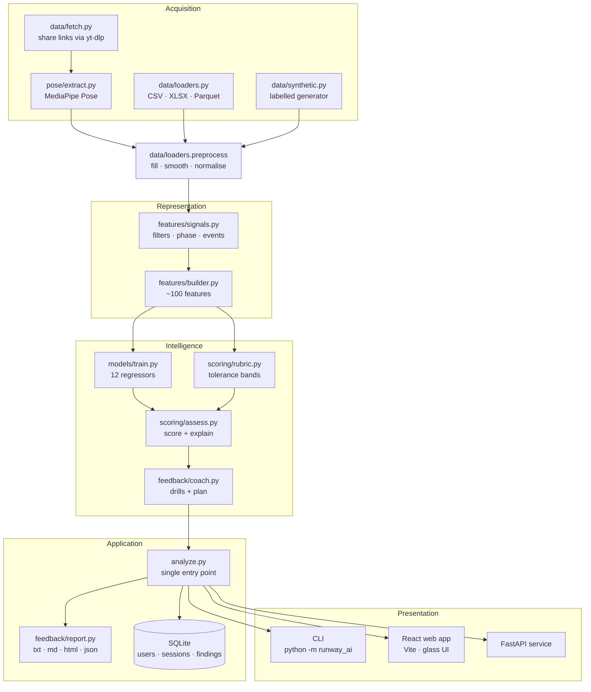
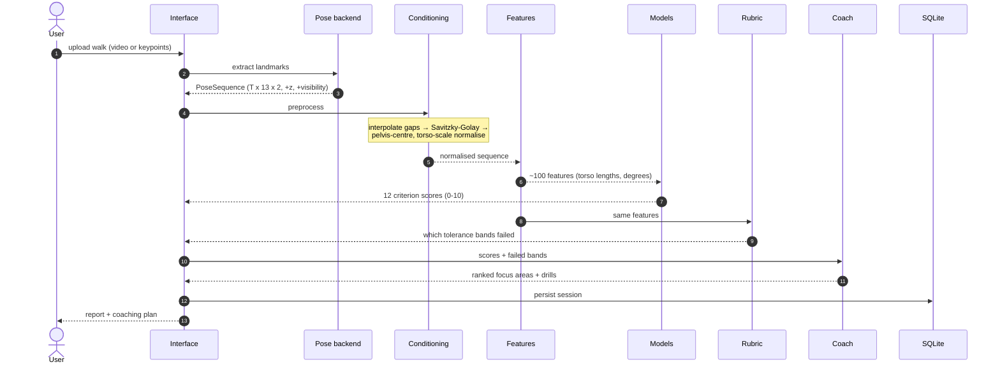
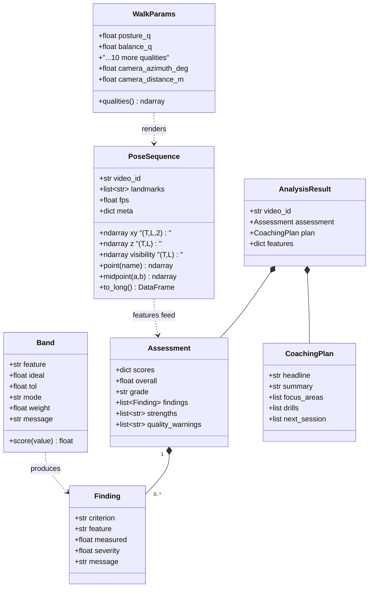
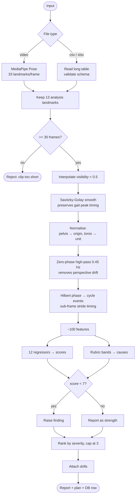

# System Architecture

## 1. Layered view

The system is a pipeline of five layers. Each depends only on the layer below,
which is why the pose estimator can be swapped without touching the model, and
the model can be retrained without touching the interfaces.



## 2. Data flow for one analysis



### 2a. Data flow for a group clip

Only the front of the pipeline differs. Once each walker has a `PoseSequence`,
they rejoin the sequence above unchanged — same conditioning, features, models,
rubric and coach — which is what makes scores comparable between people and
between a group clip and a solo upload.

```mermaid
sequenceDiagram
    autonumber
    actor U as User
    participant I as Interface
    participant Y as YuNet + SFace
    participant T as Tracker
    participant P as Pose backend
    participant A as Per-person analysis

    U->>I: upload group clip
    I->>Y: detect faces, every Nth frame
    Y-->>T: boxes + 128-d embeddings
    Note over T: one detection per track per frame<br/>(two faces at once = two people);<br/>face decides, position breaks ties
    T-->>I: PersonTrack per walker
    loop each walker
        I->>P: crop to this walker's body box
        Note over P: num_poses=1 on a crop found both<br/>walkers in 100% of frames;<br/>num_poses=4 on the full frame, 5%
        P-->>I: landmarks in crop space → mapped to full frame
        I->>A: PoseSequence
        A-->>I: scores, findings, coaching plan
    end
    I->>I: attribute each face template to an enrolled account
    Note over I: refuses to guess: needs the acceptance<br/>threshold *and* a margin over the runner-up
    I-->>U: ranked walkers + per-criterion matrix
```

Two design consequences worth stating explicitly:

* **A walker whose face is never visible cannot be separated out.** Faces are
  what make the tracks identifiable at all, so the result reports how many
  walkers it found rather than implying it found everyone.
* **Only a walk matching the signed-in account's own enrolled face is
  persisted.** Enrolling is consent to be recognised, not consent for anyone
  who films you to append to your training record.

## 3. Domain model



## 4. Processing flowchart



## 5. Why the layers sit where they do

**Pose estimation is isolated behind one function.** Everything downstream
consumes a `PoseSequence`, never a detector. That is what lets the project run
end-to-end on Python 3.14 even though MediaPipe publishes wheels only up to
3.12 — keypoint input works on any interpreter, and only video ingestion needs
the constrained environment. It is also what makes the 3D-pose and multi-camera
extensions a backend change rather than a rewrite.

**Normalisation sits before features, not inside them.** Pelvis-centring and
torso-scaling happen once, so every feature is automatically invariant to
camera distance and subject height. Doing it per-feature would guarantee
inconsistency.

**Scoring and explanation are separate.** The learned models are accurate but
opaque; the rubric is transparent but blunter. Using the model for the number
and the rubric for the reason gives both, and `assess.diagnose` gates findings
on the model's score so the two can never contradict each other in the output.
