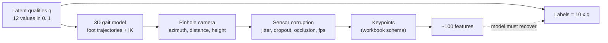

# Dataset Design

## 1. What the supplied workbook actually contains

`Synthetic_Runway_Keypoints_Sample.xlsx` — one sheet, 3,250 rows:

| video_id | frame | landmark | x | y | z | visibility |
|---|---|---|---|---|---|---|
| video_001 | 1 | nose | 0.4661 | 0.0905 | 0.0025 | 0.975 |

* 5 clips × 50 frames × 13 landmarks
* 13 landmarks are a subset of MediaPipe's 33 (no eyes, ears, heels or feet)
* No label column

**Its motion is a placeholder.** Every landmark follows the *same* sinusoid —
the per-landmark temporal standard deviation is 0.0143 for all thirteen, in
both axes. The body translates rigidly: there is no differential arm swing, no
alternating leg motion, no gait signal at all. Two consequences:

1. It cannot be trained on. There are no labels, and no motion to correlate
   with them if there were.
2. Analysing it (which the pipeline does, correctly) produces low scores and a
   "fewer than four steps detected" quality warning — the right answer for a
   1.7-second rigid-translation clip.

**Its value is the schema.** Those seven columns are adopted verbatim as the
project's interchange format, so everything generated here is drop-in
compatible with it, and any real MediaPipe extraction lands in the same shape.

## 2. The four dataset tiers

| Tier | Purpose | Status |
|---|---|---|
| **A. Supplied workbook** | Schema contract, integration test | Provided; used in `TestSchema` |
| **B. Generated synthetic corpus** | Model training and evaluation | 1,500 labelled clips, built by `scripts/build_dataset.py` |
| **C. Diagnostic corpus** | Feature validation with independent latents | `--independent` flag |
| **D. Real MoCap data** | Feature plausibility, pipeline real-data smoke-test | Provided; `data/raw/Optimal_Runway_Keypoints_from_MoCap.xlsx`|

## 3. How the synthetic corpus is built

The central problem with generating training data is that it is trivially easy
to make it circular — compute a score from a rule, then train a model to
rediscover the rule. That teaches nothing and proves nothing.

This generator avoids it by **going through physics**:



The labels come from the **hidden latents**. The features are computed from the
**noisy 2D projection**. Nothing in the feature pipeline can see `q`. Recovering
the score is therefore a genuine estimation problem under projection,
quantisation and noise — not an algebraic identity.

### Latent structure

Twelve qualities are drawn with a shared ability factor (r ≈ 0.6) plus
independent per-criterion deviation, because real walkers *are* correlated:
good posture and good balance co-occur, but someone can still have excellent
posture and a badly timed arm swing. `stage_presence` is additionally emergent,
partly determined by confidence, posture and head position.

`sample_params(correlated=False)` disables this. That destroys realism but is
essential for diagnostics — it is the only way to check that the rhythm
features respond to *rhythm* rather than riding the shared ability factor.

### Rendering

Body segments use Drillis & Contini ratios, expressed in torso lengths. Faults
map to physical changes, not to score adjustments:

| Quality | Rendered as |
|---|---|
| posture | trunk forward lean 2°→28° |
| balance | lateral sway amplitude + a ~3 Hz tremor term |
| confidence | cadence, arm abduction (tension), trunk rotation |
| shoulder_alignment | constant roll bias + per-stride roll oscillation |
| head_position | head pitch, lateral head wobble |
| arm_swing | swing amplitude error + left/right mismatch |
| hip_movement | pelvic obliquity (Trendelenburg drop) |
| rhythm | per-step tempo perturbation + hesitations |
| stride_length | stride error ±45%, both directions |
| foot_placement | step width, including crossover |
| symmetry | L/R stride, arm amplitude and phase mismatch |
| stage_presence | chest openness, chin elevation, carriage steadiness |

Three modelling details matter and were each fixed after they caused a
measurable defect:

* **Ankle stance excursion is 0.40 stride, not 0.60.** The foot is planted but
  the ankle *joint* is not — the foot rolls heel→flat→toe. Using the stance
  fraction demands a hip-to-ankle reach longer than the leg and silently
  saturates the IK, stretching the thigh by up to 13%.
* **Pelvis height is derived, not prescribed.** It sits as high as the more
  constrained leg allows (compass gait). This produces the physiological
  4–5 cm hip dip *and* is what makes stride length observable from a head-on
  camera at all, since a longer stride forces a visibly deeper dip.
* **The arm is a rigid pendulum** built from composed rotations. Constructing
  the wrist offset component-wise lets the arm stretch as it swings, and the
  projected-reach feature then measures that artefact rather than the swing.

### Camera and sensor

Pinhole projection, camera orbiting the walk mid-point at a random azimuth
(σ = 12°), distance = closest approach ∈ [3.5, 7.5] m, height ∈ [1.0, 1.6] m.
Focal length is auto-framed: it targets 78% frame fill and is reduced if that
would push a landmark out of frame — the same thing an operator does. Then:
Gaussian localisation noise scaled by depth, visibility dropouts, wrist/ankle
self-occlusion, and frame rates drawn from {24, 25, 30, 60}.

## 4. Files produced

```
data/
├── raw/          Synthetic_Runway_Keypoints_Sample.xlsx               (schema contract)
│                 Optimal_Runway_Keypoints_from_MoCap.xlsx             (Tier D real MoCap)
│                 Optimal_Runway_Keypoints_from_MoCap.xlsx.meta.json   (fps sidecar)
├── interim/      synthetic_keypoints.csv    3.9M rows, workbook schema
├── processed/    features.csv               1500 x 102
│                 labels.csv                 1500 x 33  (12 scores + latents)
└── runway.db     SQLite: users, sessions, session_scores, findings
```

`labels.csv` deliberately stores the generating parameters alongside the
scores. That is what makes the diagnostic sweeps in `scripts/sensitivity.py`
possible, and it lets any future reviewer verify that no feature accidentally
leaks a latent.

## 5. Tier D: the real MoCap dataset

`data/raw/Optimal_Runway_Keypoints_from_MoCap.xlsx` is real human Motion Capture
data in the same 7-column schema as the rest of the project.

### Contents

| Property | Value |
|---|---|
| Clips | 14 (video_001 … video_014) |
| Subjects | 7 (S1, S5, S6, S7, S8, S9, S11) |
| Sessions per subject | 1–2 (Walking, Walking1, Walking2) |
| Frames per clip | 200 (4 seconds at 50 fps) |
| Frame rate | **50 fps** — the sidecar `.meta.json` ensures this is read correctly |
| Landmarks | 13 (same CORE_13 as the rest of the project) |
| Sheet 2 (`clip_info`) | Per-clip reference kinematics for validation (see below) |

### FPS sidecar

The keypoint schema has no `fps` field. The file
`Optimal_Runway_Keypoints_from_MoCap.xlsx.meta.json` supplies `fps=50` so
`analyze.py`'s `_sidecar_fps()` reads it automatically. Without this sidecar
every cadence, rhythm and stride-timing feature is miscalculated by a factor
of 30/50 = 0.6.

### Using `clip_info` for feature validation

Sheet 2 contains reference kinematics derived directly from the MoCap capture:

| Column | Description |
|---|---|
| `steps_detected` | Step count over the 4-second clip |
| `cadence_spm` | Cadence in steps per minute |
| `step_time_std_s` | Step-time variability (standard deviation, seconds) |
| `wrist_x_amplitude` | Wrist horizontal swing amplitude (normalised units) |
| `ankle_y_amplitude` | Ankle vertical excursion amplitude |

These values are **independent ground truth** for the corresponding pipeline
features (`rhythm_step_time_mean`, `rhythm_n_steps`, `arm_swing_amp_error`,
`stride_leg_shorten_mean`). A feature that disagrees badly with the reference
for a specific subject is a signal that the feature is measuring the wrong thing
or is sensitive to the MoCap camera angle.

The `TestMoCapWorkbook` test class in `tests/test_pipeline.py` automates the
key plausibility checks. `scripts/sanity_check.py` runs a full smoke-test as
part of `run.sh verify`.

### How to analyse the file

```bash
# Full pipeline — report for all 14 clips
PYTHONPATH=src python -m runway_ai analyze data/raw/Optimal_Runway_Keypoints_from_MoCap.xlsx

# Sanity check (smoke-test + Tier-D table)
python scripts/sanity_check.py

# Run the dedicated test class
PYTHONPATH=src python -m pytest tests/test_pipeline.py::TestMoCapWorkbook -v
```

### Extending to expert-labelled real video

The MoCap file has no expert performance labels (it is walking, not runway
walking). To build a fully labelled Tier D:

1. **Recording protocol** — phone at 1.2–1.5 m height, 5–8 m from the closest
   approach, portrait, 30 or 60 fps, 6–10 second pass, plain background, full
   body in frame throughout.
2. **Consent and ethics** — written consent for recording and storage, the
   right to withdraw and delete, no identifying metadata in the released set,
   and storage of keypoints rather than video wherever possible.
3. **Expert labelling** — at least three qualified coaches score all twelve
   criteria independently on the same 0–10 scale. Report inter-rater agreement
   (Krippendorff's α, or ICC(2,k)) *before* using the labels.
4. **Splitting** — split by *subject*, never by clip.
5. **Transfer** — train on synthetic, evaluate on real, and report the gap
   honestly. Fine-tuning on the real tier with the synthetic models as
   initialisation is the natural next step.
